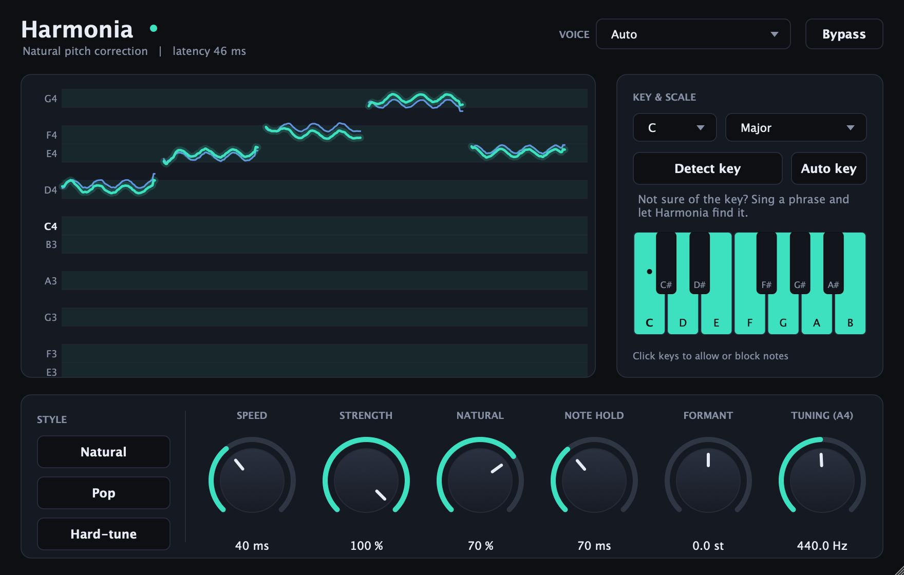

# Harmonia

Natural-sounding pitch correction for solo vocals. VST3 + AudioUnit, universal (Apple Silicon + Intel).



## Using it in FL Studio

1. Build/install (already done once): `scripts/build.sh`. This copies the plug-ins to
   `~/Library/Audio/Plug-Ins/VST3/Harmonia.vst3` and `~/Library/Audio/Plug-Ins/Components/Harmonia.component`.
2. In FL Studio: **Options → Manage plugins → Find installed plugins** (rescan), then
   add **Harmonia** (the VST3) to the mixer insert of your vocal.
3. Put it **first** in the insert chain, before reverb/delay/compression.
4. Set the **key and scale** (or click **Detect key from my vocal**, sing/play a phrase, click again).
5. Pick a **style**: *Natural* for transparent correction, *Pop* for a polished studio sound, *Hard-tune* for the robotic effect.

FL compensates the plug-in's fixed 46 ms latency automatically when mixing. If you monitor through
Harmonia while recording, you will hear that delay: record dry and add Harmonia afterwards.

## Controls

| Control | What it does |
| --- | --- |
| **Key / Scale** | Notes the voice may land on. Click piano keys to allow/block individual notes (switches to *Custom*). |
| **Detect key** | Listens to your vocal and sets key + major/minor for you, once. |
| **Auto key** | Keeps following the key of the vocal and changes it when the song modulates or a new section starts. Major/minor only; it needs about 6 s of singing before it commits, and takes about 4 s to follow a key change. Key and Scale are ignored while it is on (they still apply until the key is known). Automatable. |
| **Speed** | How fast the voice is pulled onto the note. *Instant* = robotic. 20–60 ms is transparent. |
| **Strength** | Amount of correction. 100 % = fully on the note; lower keeps more of your own pitch. |
| **Natural** | Keeps your own vibrato and expression. 100 % = all of it, 0 % = flattened onto the note. |
| **Note Hold** | How long the voice has to stay near a new note before Harmonia moves to it (default 70 ms). Stops the correction flickering to a wrong neighbouring note; a real note change is delayed by about that long. 0 = switch at once. Automatable. |
| **Formant** | Shifts vocal character without changing pitch. Leave at 0 to keep your own voice. |
| **Tuning (A4)** | Reference pitch, for songs not tuned to 440 Hz. |
| **Voice** | Bass/baritone, tenor/alto, soprano or Auto. Narrows the pitch search: faster, never jumps an octave. |
| **Bypass** | Original vocal, delayed by the latency so it stays aligned. |

The graph shows your pitch (blue) and the corrected pitch (green) over the last few seconds against the
allowed notes.

### Tips for the most natural result

* Use **Natural** style first; raise Speed only if notes still sound off.
* Choose the **correct key**. Wrong-key notes are the most audible "autotune" sign.
* Block notes your melody never uses (click the piano keys): fewer wrong-note snaps.
* Pick your **Voice** type rather than Auto if the vocal is clean and solo.
* Works on one voice at a time. Not for chords, backing-vocal stacks or full mixes.

## How it works

`detect (YIN) → pick target note + smooth the correction → PSOLA re-synthesis`

* **Pitch detection** ([PitchDetector.h](Source/dsp/PitchDetector.h)): YIN at ~24 kHz, refined at full rate; octave guard for
  strong harmonics; sub-cent precision. The pitch is measured on a low-passed copy of the voice (cutoff ~4x the pitch), so
  breath, sibilance and the non-harmonic residue left in AI-separated stems or by bleed cannot pull the detector onto a
  wrong period. A detection more than an octave away from where the voice just was is treated as a glitch (that stretch
  passes through untouched) unless it persists.
* **Correction** ([PitchCorrector.h](Source/dsp/PitchCorrector.h)): the target note comes from a "centre" of the sung note.
  Under vibrato (1.3-12 Hz, up to 6 semitones peak to peak, recognised after two big swings or three ordinary ones) the
  centre is the mean over one whole vibrato cycle, so even a +-1.5 semitone vibrato stays on one note. Without vibrato it
  follows the voice quickly, so real note changes are caught at once. A note the voice has settled on is *held*: slow drift
  (< ~70 cents/s) or a sag has to travel well past the halfway point before it counts as the next note. The correction
  is smoothed by *Speed*; *Natural* decides how much of the singer's own deviation is kept.
* **Re-synthesis** ([AutoTuneEngine.h](Source/dsp/AutoTuneEngine.h)): pitch-synchronous overlap-add (PSOLA) with sub-sample
  analysis marks. Grains are re-spaced, not resampled, so formants (the voice colour) stay where they were.
  Consonants and breaths (unvoiced) pass through untouched.
* **Note hold** (`dwellMs` in [PitchCorrector.h](Source/dsp/PitchCorrector.h)): a new target note has to persist for the hold time before it
  is adopted. While it is undecided the singer is left as sung, so a wobble or detector blip is not dragged to the neighbouring
  note. On the Earth Angel stem this cut brief (<120 ms) note flickers from 134 to 36.
* **Auto key** ([KeyTracker.h](Source/dsp/KeyTracker.h)): a pitch-class histogram of the sung notes that forgets over ~12 s of singing,
  matched against the major/minor key profiles. Glides and notes that sit between two semitones count for less. The followed key
  only changes when another key has beaten it by a clear margin for 4 s, so passing notes and drift do not move it.
* A fixed 46 ms look-ahead means the pitch track is known before the audio is re-synthesised.

## Building

Requires CMake and Xcode (clang + macOS SDK). JUCE is fetched automatically (the version is set in `cmake/Juce.cmake` at the repository root).

```sh
scripts/build.sh            # configure, build VST3 + AU + Standalone, install, ad-hoc sign
scripts/build_tests.sh      # offline DSP accuracy tests (no JUCE) + builds build-tools/{tune_wav,pitch_track,stress_corrector}
```

> `scripts/build.sh` drives Xcode's clang/SDK through Unix Makefiles on purpose: on this machine `xcodebuild`
> cannot start until `sudo xcodebuild -runFirstLaunch` is run, which also breaks CMake's Xcode generator.
> If you run that once, the stock `cmake -G Xcode` flow works too.

Extra tools:

```sh
# tune a WAV file offline (--dump writes a per-hop CSV: sung / corrected / target pitch)
build-tools/tune_wav in.wav out.wav --key A --scale minor --speed 40 --natural 0.7 --dump hops.csv

# independent pitch track (t, midi every 5 ms) of any WAV, e.g. to compare input and output
build-tools/pitch_track in.wav track.csv

# synthetic stress scenarios for the corrector: huge vibrato, drift, sagging notes (--csv dir writes the contours)
build-tools/stress_corrector

# follow the key of a WAV by itself (prints when it changes)
build-tools/tune_wav in.wav out.wav --autokey 1

# run a WAV through the real plug-in processor (bit-identical to tune_wav at equal settings)
build/HarmoniaDevTool_artefacts/Release/HarmoniaDevTool process in.wav out.wav 0 0

# headless processor self-test and editor screenshot
cmake --build build --target HarmoniaDevTool
build/HarmoniaDevTool_artefacts/Release/HarmoniaDevTool selftest
build/HarmoniaDevTool_artefacts/Release/HarmoniaDevTool snapshot ui.png
```

## Test results (synthetic voices, 22–192 kHz)

* Steady notes land within ~0.05 cent of the target; wobble < 1 cent (E2 to C6, two vowels).
* Vibrato depth kept ≥ 100 % at *Natural 100*, ≤ 15 % at *Natural 0*.
* Formants unchanged when shifting 3 semitones (spectral centroid ratio 1.04; naive resampling gives 1.19).
* ~0.8 % of one core (stereo, 48 kHz; ~1.4 % at 96 kHz). Passes `auval` and `pluginval` at strictness 10.

## Layout

```
Source/dsp/        JUCE-free engine: Scales, KeyTracker, PitchDetector, PitchCorrector, AutoTuneEngine,
                   Kernels (SIMD-friendly sums), Rings (history buffers)
Source/            PluginProcessor (parameters, host glue), PluginEditor
Source/ui/         Theme/look-and-feel, PitchGraph, NoteKeyboard
Tests/             dsp_test, tune_wav, DevTool, synthetic voice generator
scripts/           build.sh, build_tests.sh, toolchain.sh (shared Xcode clang/SDK lookup)
```
