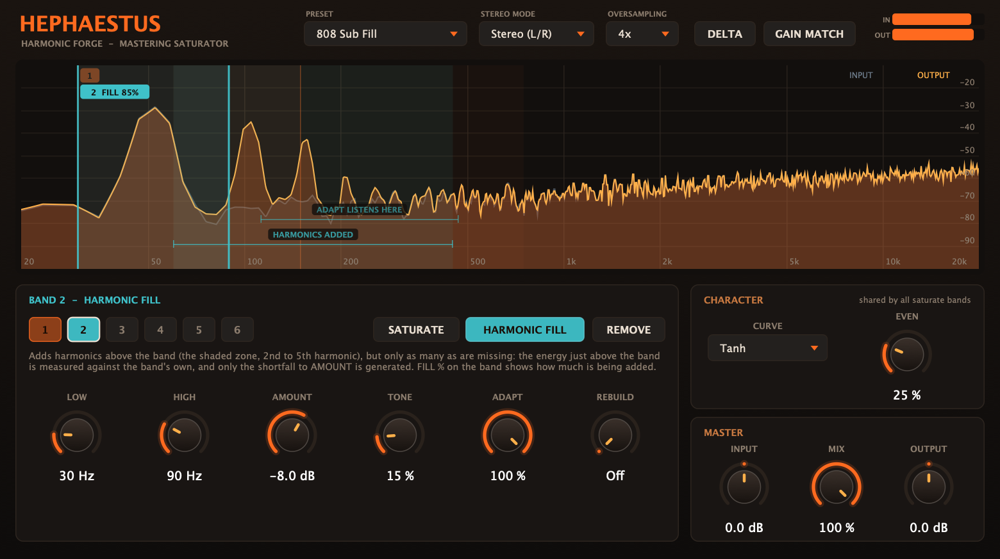

# Hephaestus — harmonic forge for mastering

A saturation plugin (VST3 / AU / Standalone, macOS universal) that fills in harmonics and
missing fundamentals for tonal balance. Built with JUCE 8 for FL Studio (VST3/AU on macOS).



*An 808-style sub note (52 Hz) with nothing above it, in the "808 Sub Fill" preset. Band 2 (cyan) is a Harmonic Fill band: the grey input trace has no energy above the note, the orange output has grown harmonics at 104 and 156 Hz, and the band's tab reads FILL 85 % because that is how much of its Amount it is currently adding. The tinted zone under "HARMONICS ADDED" is where that band's harmonics land; "ADAPT LISTENS HERE" marks the region the adaptive fill measures.*

You draw **bands** over the spectrum. Each band is one of two things:

| Band mode | What it does |
|---|---|
| **Saturate** (orange) | Drives the sound inside the band into a waveshaper (ADAA + linear-phase oversampling), so harmonics appear above it. Per-band Drive; Curve and Even are shared. Anything outside the band is left exactly as it is. |
| **Harmonic Fill** (cyan) | Adds harmonics (H2-H5) of the band's content *above* the band, but only as many as are missing. The energy just above the band is measured against the band's own, and only the shortfall to **Amount** is generated, so the balance holds from one moment to the next instead of piling harmonics onto passages that already have them. Optionally **Rebuild** also regenerates a fundamental that is physically missing while its harmonics are present (difference tone, 3f - 2f = f). |

Both kinds show where they add harmonics: the selected band gets a bracketed zone labelled **HARMONICS ADDED**, from the 2nd harmonic of its Low edge to the 5th of its High edge (stopping short of Nyquist, and for a fill band short of any harmonic that would alias); every other band shows it as a faint tint. A fill band with Amount off adds none and shows none.

Up to six bands, any ranges, overlapping or not. Mastering tools: **Delta** (hear only what the plugin adds), **Gain Match** (loudness-matched A/B), **Mid/Side** mode, **Mix** (latency-compensated), and a live **input-vs-output spectrum**. The analyzer follows FabFilter Pro-Q's: an 8192-point FFT, **4.5 dB/oct tilt around 1 kHz** by default, a 90 dB range, fast attack and a selectable release. Right-click empty space in it for Range (60/90/120 dB), Speed and Tilt (0/3/4.5/6 dB/oct); the choice is saved with the project.

## Why Harmonic Fill is adaptive

A tonal-balance EQ fixes the *average* curve. It cannot fix a mix whose curve looks balanced but whose energy is not: a sub note with nothing above it, a bar where the low mids go empty, a section where they are full. Boosting those regions with an EQ lifts whatever happens to be there, and a fixed-amount harmonic generator adds the same harmonics whether or not they are already present. Harmonic Fill closes the loop instead:

```
band energy        E_b   (the band-passed input, ~100 ms)
energy above band  E_a   (input, from 1.25 x High up to 5.2 x High, same smoothing)
wanted             E_w = E_b x Amount          (Amount in dB, as an energy ratio)
shortfall          s   = 1 - min (1, E_a / E_w)
gain on harmonics  g   = (1 - Adapt) + Adapt x sqrt (s)       (smoothed over ~50 ms)
```

The measurement is made on the *input*, so there is no feedback to destabilise. **Adapt 0 %** is the old fixed-amount behaviour; **Adapt 100 %** adds only the shortfall. The harmonics are generated with exact weights (Chebyshev polynomials of the band signal divided by its own envelope, see below), so a hollow passage gets precisely `Amount` of harmonic energy and a full one gets none. This was measured (see Verification): at Amount -6 dB a hollow passage gets **-6.3 dB** of added energy relative to the band, a passage that already has plenty above the band gets **nothing**, and a quarter-filled one gets 0.76 of the full amount where the law predicts 0.80.

What it does *not* do: it judges "already there" by energy in a fixed region above the band, not by whether that energy is musically the right harmonics. Dense material above the band will make it back off. Raise Amount to ask for more energy above the band, lower Adapt to add regardless.

## Using it in FL Studio

1. FL Studio -> *Options -> Manage plugins* -> *Find plugins* (the VST3 is installed in
   `~/Library/Audio/Plug-Ins/VST3/Hephaestus.vst3`).
2. Put it on the master (or a bus) **before** the limiter. Latency (shown by FL as PDC) is
   reported automatically; it changes with the Oversampling setting.
3. **Make bands.** Double-click the spectrum where you want one and choose *Saturate* or *Harmonic Fill*, or use the buttons in the band panel. Drag a band's edges to resize it, its body to move it; right-click it to change its mode or remove it. The band panel below shows the selected band's controls; the numbered chips pick a band.
4. **Or start from a preset:**
   - **Thin or small-speaker bass:** *Missing Fundamental* or *Small-Speaker Bass*. Put a Harmonic Fill band over the fundamentals you want to support. Watch the FILL % on its tab and confirm with **Delta**.
   - **808 / sub that disappears on laptops:** *808 Sub Fill*.
   - **Glue and warmth:** *Master Glue* / *Warm Tube* / *Tape Body*. Use **Gain Match** so more saturation isn't mistaken for "better".
   - **Dull top end:** *Air Exciter* (a saturate band over the highs; harmonics land above it).
5. Judge with **Delta** and with the analyzer. The display is tilted +4.5 dB/oct (as Pro-Q's default) so typical programme material looks flat.

### Parameter guide

Every band has its own **Low** / **High** edge (20 Hz - 20 kHz; a fill band stops at 2 kHz, and an edge can't come closer than a ratio of 1.5).

- **Saturate - Drive** - how hard the band is driven into the curve. Small signals stay untouched whatever the drive.
- **Curve / Even** (shared by all saturate bands) - Even 0 % = symmetric curve -> odd harmonics only (3rd, 5th...); higher = asymmetric -> adds 2nd, 4th... (tube-like). Curves: Tanh (smooth), Atan (open, tape-like), Soft (algebraic, gritty, strongest upper odd harmonics).
- **Fill - Amount** - harmonic energy above the band relative to the band's own, in dB; also what Adapt aims to keep there. Off at the minimum.
- **Fill - Tone** - which harmonics carry that energy: dark = mostly the 2nd; middle = the usual virtual-bass roll-off (-3 / -9 / -16 dB for H3 / H4 / H5 re H2); bright = led by the 3rd. The four weights always carry unit energy, so Amount means the same at any tone.
- **Fill - Adapt** - see above. 100 % = only what is missing.
- **Fill - Rebuild** - regenerates a fundamental that is missing inside the band from the difference tone of the harmonics that are present, and only where it is missing. Off by default; experimental on dense material.
- **Oversampling** - Off / 2x / 4x / 8x, linear-phase. 4x is the default.
- **Stereo mode** - Mid/Side saturates M and S; fill bands then work on Mid only so bass stays centred.

## Research this is based on

- **Missing fundamental / virtual bass.** Larsen & Aarts' book *Audio Bandwidth Extension* (Wiley, 2004) frames the nonlinear-device (NLD) approach; Bai & Lin (JAES 2006) introduced phase-vocoder virtual bass; Mu, Gan & Tan (ICASSP 2012) and Hill & Hawksford (2010) built hybrids. The trade-off reported in that literature: **NLDs keep transients but give no control over individual harmonics; phase vocoders give precise harmonic weighting but smear transients.** Overview via [Eloi et al., DAFx 2020](https://acris.aalto.fi/ws/portalfiles/portal/51973173/Eloi2020_Virtual_bass_DAFx2020.pdf).
  → *Hephaestus' answer:* divide the bass band by its own envelope, apply Chebyshev polynomials T2–T5, multiply the envelope back. For a unit sine, T*k* gives exactly the *k*-th harmonic (the weights are exact and level-independent), yet the processing stays in the time domain (no smearing). See [Csound `chebyshevpoly`](https://csound.com/manual/opcodes/chebyshevpoly/) and the [UW lecture notes](https://courses.cs.washington.edu/courses/cse490s/11au/lectures/E-Non-linearSynthesis.pdf).
- **Typical harmonic weighting.** Hobbyist virtual-bass designs use roughly −6/−12/−18/−24 dB for H2–H5 ([DIYAudio thread](https://www.diyaudio.com/community/goto/post?id=3684217)); the defaults here are in that region. Vendor claims for how far below the speaker's limit MaxxBass works vary (1.5–2 octaves), and its algorithm is proprietary, so this is not a MaxxBass clone.
- **Aliasing.** First-order antiderivative anti-aliasing (Parker, Zavalishin & Le Bivic, DAFx 2016; extended in [Werner & Azelborn, DAFx 2023](https://www.dafx.de/paper-archive/2023/DAFx23_paper_61.pdf)) suppresses but does not eliminate aliasing, and misbehaves in single precision at extreme drive ([JUCE forum](https://forum.juce.com/t/anti-derivative-anti-aliasing-adaa-issues/46993)). → ADAA runs in `double`, with a midpoint fallback, *inside* linear-phase oversampling.
- **Host behaviour.** Latency changes must be reported from the message thread ([JUCE forum](https://forum.juce.com/t/bug-setlatencysamples-crashes-ableton-live-10-vst3-fixed/40216)), and the legacy parameter API breaks VST3 automation ([JUCE forum](https://forum.juce.com/t/vst3-automation-with-legacy-parameter-handling-broken/44854)). → latency goes through an `AsyncUpdater`; all parameters use the versioned `ParameterID` API.
- **Even vs odd harmonics.** Sources disagree on which sounds "warmer" ([iZotope](https://www.izotope.com/en/learn/what-is-audio-saturation) vs. a [CreativeLive/Ozone lesson](https://phoenix.creativelive.com/class/mastering-music-with-izotope-ozone-11-tomas-george/lessons/saturation-vintage-tape-module-and-exciter-module)), so Even is a continuous control rather than fixed "tube/tape" types. Trust your ears and Delta.

## Signal flow

```
in -> gain -+- dry (delayed by latency) ------------------------------------------------------+
            +- [M/S enc] -+- fill band x N (base rate, adaptive) -> sum -> delay -----+          |
                          +- saturate band x N: band-pass -> up -> ADAA -> down -> sum +- + -- [M/S dec] -- [gain match] -- mix/delta -- out
                          +- clean copy, delayed by the oversampling latency ----------+
```

Details that matter:

- **A saturate band adds only its distortion.** Each band shapes a band-passed copy of the signal and the *difference* (what the shaper added) is summed onto the untouched, latency-matched input. Nothing the user has not asked for is filtered, so bands can overlap or leave gaps and the plugin is exactly transparent at small signal for any arrangement (0.000 dB, six overlapping bands at 18 dB drive). It replaces a fixed three-band LR4 split, whose bands must sum flat and so cannot move freely.
- **ADAA is applied to the nonlinear residual only** (`f(u)` minus its tangent line at the bias point). Plain first-order ADAA is a `[1 1]/2` low-pass in the linear regime (about -5 dB at 15 kHz at 48 kHz); this form keeps small-signal gain exactly 1 while still anti-aliasing the distortion. The DC blocker acts on the residual only, so bass in the clean path is never phase-shifted.
- **The fundamental engine runs at the host rate**: a fill band's range stops at 2 kHz, so its harmonics stay well below Nyquist (a harmonic that would land above 0.48 x fs is dropped) and there is nothing to alias.
- **The Chebyshev envelope releases slowly (`6 / lo`).** The k-th harmonic scales as `a^k` where `a` is the normalised amplitude, so envelope droop between waveform peaks costs accuracy mostly in H4/H5. Doubling the release from `3/lo` cut the worst-case error from 1.26 dB to 0.38 dB at 60 Hz, with harmonics still 48 dB down 50 ms after a note ends.
- **Rebuild's gap detector** compares input vs restored energy per frequency in a bank of narrow resonators. Comparing against the whole band mistakes a 2nd harmonic for an existing fundamental, and correlating with the restored signal fails because a difference tone is in phase quadrature with the true fundamental of saw-like waveforms. Both were tried first and failed the test suite.
- **Bands fade in and out** over one block when they are added or removed, and a removed band costs no CPU.

## Verification (all run on the final binaries)

`HephaestusTests` (headless DSP, `Tests/Tests.cpp`) - measured, not assumed:

| Check | Result |
|---|---|
| Small-signal frequency response, 40 Hz-20 kHz, every oversampling mode | flat within **0.001 dB**; also with six overlapping bands at 18 dB drive |
| Dry path vs reported latency | dry impulse lands **exactly** on the reported latency (49 / 61 / 65 samples at 2x / 4x / 8x); the wet impulse lands on it too |
| Alias energy, 5.3 kHz sine, +18 dB drive (re fundamental) | naive tanh **-18 dB** -> ADAA only **-30 dB** -> with oversampling **-70 to -72 dB** |
| Even control | bias 0: H2 < -160 dB; bias 0.5: H2 -15 dB |
| A saturate band acts only on its range | 100 Hz sine, +24 dB drive: 3rd harmonic **-11 dB** with the band on the tone, **-120 dB** with the band at 2-4 kHz |
| Where the harmonics land (the shaded zone) | band-limited noise through a saturate band at 6 / 12 / 24 dB drive: **0.00 - 0.02 %** of what it adds lies above 5 x High; through a fill band: **0.45 %**, with 81 % of the added energy inside the zone (the rest sits just below it, from intermodulation of a noisy band) |
| Sample rates 22.05 - 192 kHz | small-signal error **3e-8** (-60 dBFS in, input delayed by the reported latency), loud mixed bands finite and bounded |
| Harmonic weights vs targets (-6/-9/-15/-22), 45 / 60 / 90 Hz, two input levels | within **0.6 dB** (0.3 dB mid-range), identical at -6 and -26 dBFS |
| Harmonic tails | 48 dB down 50 ms after note-off, 95 dB down at 100 ms |
| Tone | the four H2-H5 weights carry unit energy at every tone; dark is H2, bright is led by H3 |
| **Adaptive fill**, 60 Hz band, Amount -6 dB | Adapt 0 %: a hollow and a full passage get the same (+0.6 dB apart). Adapt 100 %: hollow passage **-6.3 dB** re band (target -6.0); plenty above the band: **nothing**; a quarter of the target above the band: **0.76** of the full amount (law: 0.80) |
| Rebuild, 120+180 Hz present, 60 Hz missing | restores 60 Hz at 0.299 (target 0.3); tracks level linearly (-6.0 dB for -6 dB); backs off to **0.000** when the real fundamental exists (0.230 when missing) |
| Mid/Side keeps bass centred | 2nd harmonic of a side-only tone: -5.7 dB in L/R mode, **-93 dB** in M/S mode |
| Mix / Delta | mix = 0 is the input delayed by exactly the latency; delta = wet - dry and mix = 0.37 is the linear blend, all **sample-exact** |
| Switching a band off | after the fade the output is the delayed input, **sample-exact** (max error 0) |
| Gain Match | a -4.9 dB level drop becomes **0.0 dB** |
| Spectrum analyzer | a bin-centred -6.02 dBFS sine reads **-6.02 dB**; 4 kHz with 4.5 dB/oct tilt reads +2.98 dB (expected +2.98); off-bin worst case -7.44 dB (Hann scalloping, < 1.5 dB); left-only signal reads -3 dB (L/R power is averaged) |
| 600 randomised blocks (all params incl. six random bands, block sizes 1-1500, mono/stereo, mode switches) | always finite |
| CPU, 10 s stereo, six bands on (4 saturate, 2 adaptive fill with Rebuild) | 2 % (no OS) -> 15 % of one core (8x), Apple M4 |

`HephaestusUiCheck` drives the real spectrum component with synthetic mouse events: a band added at 1 kHz takes the first free slot; clicking where bands overlap selects the narrowest; dragging an edge moves only that edge; dragging the body keeps the width ratio; an edge can't cross the minimum width; a fill band is pulled to at most 2 kHz; a full plugin refuses a seventh band and reuses a freed slot.

`HephaestusHostCheck` loads the installed **VST3** through JUCE's host wrapper: 5 sample rates (22.05-192 kHz) x 5 block sizes (1-4096) with every parameter randomised, latency reporting follows the oversampling choice (0 / 49 / 61 / 65 samples) and an impulse through the loaded plugin comes out exactly that many samples later, state and all 8 presets round-trip, and a session saved with the old fixed three-band layout loads as three saturate bands plus one fill band. Apple's `auval` passes for the **AU**.

## Known limitations (honest list)

- **Not yet tested inside FL Studio itself.** It was validated through JUCE's VST3 host and `auval`; *pluginval* was not run (the sandbox blocked executing the downloaded binary). Load it in FL and report anything odd.
- **The mouse interaction has been checked with synthetic events, not by hand in a DAW.** Dragging, the add/remove menus and the band panel are covered by `HephaestusUiCheck` and screenshots, but not by a person using them.
- **The adaptive fill judges "already there" by energy, not by harmonic content.** It compares the energy from 1.25 x High to 5.2 x High with the band's own; anything in that region counts, whether or not it is related to the band. On dense material it will often back off completely: that is the intended behaviour (the energy exists), but raise Amount or lower Adapt if you want it to add regardless. The Chebyshev weights are exact for sine-like band content; noise-like band content gives somewhat different harmonic energy, so the target is approximate there.
- **Rebuild is experimental.** A squarer produces difference tones between *all* component pairs in its input band, so dense low-mid material can yield inharmonic bass content. It suits sparse bass material; leave it off for full mixes unless Delta says it helps.
- **A saturate band shapes a band-passed copy** (4th-order Butterworth edges), and what the shaper added is summed onto the clean signal. Near a band's edges, where that copy's phase has turned, the shaper's gain reduction on the fundamental is applied with that phase. This was not measured separately; overlap bands or check with Delta if a band edge sits on something important.
- **Gain Match** is a slow (~0.6 s) RMS match, clamped to +-12 dB. It will partly undo a deliberate bass boost, since low-end energy dominates RMS; that's why it's off by default.
- **The analyzer's absolute level** uses a Hann window, so a sine falling between FFT bins reads up to 1.4 dB low. Its tilt and range options mirror Pro-Q's, but it is not a Pro-Q clone: Pro-Q's smoothing and peak-hold details are not published.
- **Ad-hoc signed, not notarised.** Fine on this Mac. Distributing it needs a Developer ID signature and notarisation.
- Windows/Linux builds should work (JUCE is cross-platform) but were not built or tested.

## Build

```bash
# macOS. SDKROOT works around Command Line Tools shipping an SDK this Xcode's linker can't read.
export SDKROOT=$(xcrun --sdk macosx --show-sdk-path)
cmake -S . -B build -DCMAKE_BUILD_TYPE=Release    # fetches JUCE (version in cmake/Juce.cmake); an offline copy in third_party/JUCE at the repository root is used if present
cmake --build build --target Hephaestus_VST3 Hephaestus_AU Hephaestus_Standalone   # installs to ~/Library/Audio/Plug-Ins
cmake --build build --target HephaestusTests && ./build/HephaestusTests_artefacts/Release/HephaestusTests
cmake --build build --target HephaestusHostCheck && ./build/HephaestusHostCheck_artefacts/Release/HephaestusHostCheck ~/Library/Audio/Plug-Ins/VST3/Hephaestus.vst3
cmake --build build --target HephaestusUiCheck && ./build/HephaestusUiCheck_artefacts/Release/HephaestusUiCheck
cmake --build build --target HephaestusSnapshot   # renders the editor to PNG
```

See `CLAUDE.md` for the design invariants and the single-source-of-truth map before changing anything.

## Layout

```
Source/DSP/Band.h                band modes, range rules shared by engine and display
Source/DSP/Biquad.h              double-precision biquads, Butterworth cascades, Bandpass pair
Source/DSP/Waveshaper.h          tanh / atan / algebraic curves + residual ADAA
Source/DSP/Saturator.h           user-placed saturate bands, per-band oversampling + shaping
Source/DSP/FundamentalEngine.h   Chebyshev harmonics + adaptive fill + difference-tone rebuild + gap detector
Source/DSP/Engine.h              latency alignment, band mixing, M/S, gain match, delta, meters
Source/DSP/AnalyzerTap.h         lock-free FIFOs feeding the display
Source/DSP/SpectrumAnalyzer.h    Pro-Q-style FFT analyzer (GUI-free, unit-tested)
Source/Parameters.h              parameter layout, presets, band helpers, legacy-session migration
Source/PluginProcessor.*         JUCE wrapper
Source/PluginEditor.*, UI/       band panel, look-and-feel, spectrum view with draggable bands
Tests/                           DSP tests, UI check, VST3 host check, editor snapshot, shared helpers
docs/screenshot.png              editor render (generated by HephaestusSnapshot)
```
