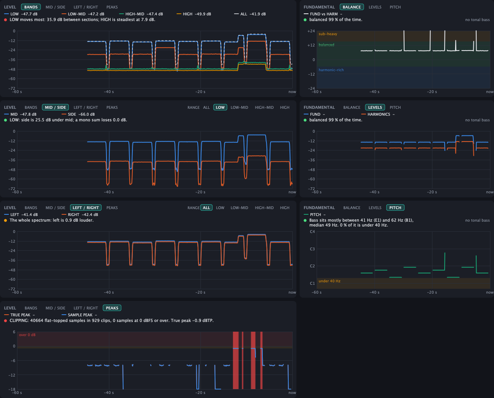

# Themis Verdict

*Themis* is the project, *Verdict* is the plugin: the mastering checks, and the verdict they add up to.

Themis Verdict is a **mastering check suite in one plugin** for any VST3 / AU host: tonal balance against a
reference curve, device translation, mono fold and phase cancellation, stereo correlation, clipping and true peak, low-end dynamics, bass fundamental and energy over time: what you
need to look at before you call a master done.

It is **clean and transparent: for monitoring and decisions only.** It has no EQ, dynamics, limiter or gain stage; the
audio passes through bit-for-bit unchanged with zero latency, so it is safe to leave on the master bus. The one exception is
the **Solo / Mute audition**, which changes what you *hear* only while a button is pressed (never saved, never applied to a
render). Every readout is there to inform a decision you make with your own tools, and the **master plan** turns them all
into a short list of what to do next.

- **Source only.** This repository contains the code, not a download: to use Themis you build it yourself (see
  [Build](#build-macos)). It is free software under the **AGPL-3.0-or-later** ([LICENSE](LICENSE), [NOTICE.md](NOTICE.md)),
  without warranty, and not affiliated with any other product named in these pages.
- The interface is built like a piece of studio hardware with a digital brain: brushed-metal modules, glass displays with
  phosphor traces, lamps for every verdict, push switches that light up, rotary knobs with lit scales and a swing-needle
  correlation meter. It is drawn entirely from code: no image, font or sound files are shipped.
- Formats: **VST3 + AU** (macOS, universal arm64 + x86_64, macOS 11+), VST3 + Standalone on Linux/Windows if you build there.
  There is no VST2 build: VST2 is not available for new plugins.
- Built with [JUCE](https://juce.com) 8. All DSP lives in a dependency-free C++17 core ([core/include/themis](core/include/themis))
  with its own unit tests.


*Headless render of the editor (the hardware-style interface: brushed-metal modules, glass displays, lamps, knobs) measuring a synthetic programme: a four-note bass line over pink noise whose right channel is 0.5 ms late and 1 dB quieter, with a loud "chorus" driven into a hard clipper at -1 dBFS. The **MASTER PLAN** (top right) ranks what to do: stop the clipping, remove the 0.50 ms channel offset (PHASE CHECK reports it and outlines the comb-filter region, about 500 Hz–1.5 kHz, on the mono-fold strip), cut the over-heavy low end, and so on; its HEAR chip on the second item has put SIDE on solo in the **AUDITION** strip (red outline: the output is altered). CLIPPING is red with the clip count, the FUNDAMENTAL readout and graph follow the bass, and the LEVEL graph shows the notes and the louder chorus. The tonal curve looks wild because the demo is not music. Regenerate with the command under "Develop".*



*The same programme in every tab of the two graphs: LEVEL (BANDS, MID / SIDE on the LOW range, LEFT / RIGHT, PEAKS with the clipped frames in red) and FUNDAMENTAL (BALANCE, LEVELS, PITCH). Each tab ends in a traffic-light verdict line.*

## Features

| Area | What it does |
|---|---|
| **Master plan** | **MASTER PLAN** (top right) reads every measurement below and lists what to do to the master, **worst first**, with the amount and the place: *"Cut about 2.5 dB at 250 Hz - 630 Hz (broad bell)"*, *"Remove the 0.50 ms offset between the channels"*, *"Take about 3 dB off the limiter's gain: -11.2 LUFS against a -14 LUFS target"*, *"Lower the limiter ceiling by 0.6 dB, to -1.0 dBTP"*, *"Make the low end mono: high-pass the side channel around 150 Hz"*, *"Open up the low end: ease the compression on the bass by about 2 dB"*. The headline says what to change and by how much, **hover for why** (the numbers behind it, and which limit was crossed); the verdict in the corner counts what is left to fix (`READY` when nothing is). The tonal moves are the *smallest* EQ move that brings the region back inside the target band (the tooltip also gives the move to the target centre), rounded to the half dB an EQ is set in. Checks: clipping and peak ceiling, loudness against the **Deliver for** target, phase cancellation, low-end mono, mono fold, tonal balance (up to the two biggest out-of-tolerance regions), low-end crest, left/right balance, bass (under 40 Hz, sub-heavy / thin), the low end's steadiness between sections and translation to the selected device. Items that can be listened to have a **HEAR** chip: it sets the Solo / Mute audition (e.g. SIDE + LOW for low-end mono, the flagged range for a tonal move); click again (STOP) to release. It needs audio: press **Reset**, play the whole track (20 s minimum, and the longer the better; set Averaging to Infinite for a whole-track measurement). Clipping is judged at once. All limits are rules of thumb, not measured data, and the plan is only as good as the audio that has played: it is a checklist for your ears and your tools, not a replacement for them. See [MasterAdvisor.h](core/include/themis/MasterAdvisor.h). |
| **Loudness** | Integrated loudness (ITU-R BS.1770 / EBU R128, K-weighted, gated) since the last Reset, shown under MASTER PLAN with the true peak and the **PLR** (peak-to-loudness ratio, true peak minus integrated LUFS: how much dynamic range the limiter left). **Deliver for** picks the target: *Streaming -14 LUFS* (Spotify, YouTube and Tidal turn a louder master down to about that, so the extra level buys nothing there and costs punch), *Loud release -9 LUFS* or *Dynamic -18 LUFS*. More than 2 LU away from it is a warning, more than 4 LU is bad; too quiet says whether the peak leaves room to raise it by plain gain. The targets and limits are rules of thumb. See [LoudnessMonitor.h](core/include/themis/LoudnessMonitor.h). |
| **Audition (Solo / Mute)** | **AUDITION** (bottom right) has **S**olo and **M**ute for **MID** (the centre, what a mono sum keeps), **SIDE** (what differs between the channels, what a mono sum loses), **LEFT**, **RIGHT** (a soloed channel plays on both sides) and the four ranges **LOW / LOW-MID / HIGH-MID / HIGH** (the same ranges as the readouts; 4th-order Linkwitz-Riley crossovers at 120 Hz, 1 kHz and 6 kHz). Within each group a solo silences the rest, a mute silences that source; groups combine (SIDE + LOW plays the side signal below 120 Hz, which is exactly the part of the low end a mono playback system throws away). Changes fade over 10 ms. **CLEAR** releases everything; while anything is engaged the panel is outlined red and says OUTPUT ALTERED. **The measurements always see the input**, never the audition, so the curve, the plan and the graphs do not move when you solo. It is the only thing in Themis that changes the output: with nothing pressed the audio is untouched bit for bit, the state is **not saved** with the session or exposed to the host, and it is **ignored while the host renders offline**, so an export cannot carry it. Put Themis last in the chain (or after your limiter) to hear what you are judging. See [Audition.h](core/include/themis/Audition.h). |
| **Tonal balance curve** | 1/6-octave long-term spectrum (20 Hz–20 kHz) vs a target *median ± tolerance* band. Segments turn green / amber / red as you leave the band. Four broadband readouts (Low / Low-Mid / High-Mid / High) show your average offset from target. A **Low Crest** meter shows the peak/RMS ratio of the 20–250 Hz band in dB: left = dynamic, right = compressed; its "typical" zone (6–10 dB) is a hand-authored guess. Averaging: 10 s / 30 s / 2 min / infinite; **Reset** restarts it. **The curve does not depend on loudness:** every analysed moment is normalised by its own total energy before averaging (so gain changes, and loud choruses vs quiet verses, don't move it), and near-silent moments are gated relative to the programme level rather than at a fixed dBFS. |
| **Translation checks** | Analysis-only help for judging how a master will carry over to other playback systems. **Device preview:** pick *Translate to* → Phone speaker / Laptop / Earbuds / Bluetooth speaker / Car / Small monitors (or Off). The curve is redrawn as that device would reproduce it (dashed line) and the range it cannot reach is darkened. **DEVICE LOSS** is how much more level your track loses through the device than the target curve does (so a bass-heavy master reads high on a phone). **Mono fold** is measured per band from the same frames as the tonal curve (level independent): the strip under the curve colours each band green / amber / red by the power lost in a mono sum, and **MONO FOLD**, **LOW-END MONO** (< 150 Hz) and **WORST BAND** summarise it. Hover the readouts for the numbers. The device responses are generic approximations (a bass limit, a treble limit and a few broad bumps), not measurements of any product, and the green/amber/red limits are rules of thumb; both are defined in [Translation.h](core/include/themis/Translation.h). The audio is never filtered. |
| **Phase-cancellation check** | **PHASE CHECK** catches stereo phase problems that a mono sum would turn into lost level. Per band, the left/right cross-spectrum is averaged like the tonal curve (so it follows the averaging time and is level independent): a band *cancels* when a mono sum loses more than the 3 dB that uncorrelated channels lose. The widest cancelling region is outlined on the mono-fold strip, and the verdict names the likely cause by fitting the inter-channel phase of the coherent bands with a pure model: **Polarity flipped** (one channel inverted), **Delay x ms** (a fixed offset, i.e. comb filtering, with the first notch frequency in the tooltip) or a frequency range when the phase is neither (stereo wideners, phase-shifting effects, a mixed source). Unlike the broadband correlation meter it says *where*, and it still works when the mid signal is silent. See [PhaseCancellation.h](core/include/themis/PhaseCancellation.h). |
| **Clipping detection** | **CLIPPING** (second readout row) is a true-peak meter since the last **Reset** with the clip count next to it. The audio is checked sample by sample: *sample peak*, *true peak* (4× oversampled inter-sample peak, dBTP), *over* (a sample at or above 0 dBFS) and *clips*, meaning flat tops: at least 4 equal samples in a row above −6 dBFS that the waveform ran into, which a hard clipper or an overdriven limiter leaves at any ceiling, not only at 0 dBFS. Any clip or over is red, a true peak above −1 dBTP is amber (lossy encoding can push it over) and above 0 dBTP red; those limits are rules of thumb. The **PEAKS** tab of the LEVEL graph shows *when* it happened, with the clipped frames as red columns. A synthesised square wave or a held level also looks like a flat top, and a clip that was smoothed afterwards (a soft clipper, a lowpass) leaves none to find. Audio thread cost: about 0.6 % of one core at 48 kHz. See [ClipMeter.h](core/include/themis/ClipMeter.h). |
| **Level and fundamental graphs** | Two scrolling graphs (last 60 s) under the tonal view, each with **tabs**, a **legend that is also the readout** (click an entry to hide its line; hover for the values at that moment) and a **verdict line** that turns the window into a decision (green / amber / red; the limits are rules of thumb, see [HistoryChecks.h](core/include/themis/HistoryChecks.h)). **LEVEL** is absolute energy (mean-square dBFS, unlike the level-independent tonal curve): **BANDS** (LOW / LOW-MID / HIGH-MID / HIGH and the whole spectrum; the verdict names the range that moves most between sections, the low end holding steady being the point), **MID / SIDE** and **LEFT / RIGHT** (each with a RANGE selector, so you can check the low range alone: the verdict is the mono loss with the same limits as MONO FOLD for mid / side, and the level difference for left / right) and **PEAKS** (sample and true peak, shaded 0 dB and −1 dBTP zones, clipped frames in red). **FUNDAMENTAL** tracks the bass fundamental (lowest tonal peak in 30–250 Hz of the mid signal, from the analyser's own FFT): **BALANCE** plots how far it sits above its harmonics 2–8 on a track shaded *sub-heavy* / *balanced* / *harmonic-rich* (the verdict is where it sat most of the time), **LEVELS** the two levels and **PITCH** its note on a note axis with the region under 40 Hz that small speakers cannot play shaded (the verdict is the share of time spent there). See [Fundamental.h](core/include/themis/Fundamental.h) and [FrameHistory.h](core/include/themis/FrameHistory.h). |
| **Stereo vectorscope** | Goniometer (mid vertical, side horizontal) of the last ~30 ms plus a phase-correlation meter (-1 out of phase … +1 mono, ~0.4 s smoothing). The plot auto-scales to the recent peak so it stays readable at any level; click it to switch to a fixed 0 dBFS scale. Display only; the audio is untouched. |
| **Target curves** | 7 built-in starter curves (Flat, Modern Pop, Hip-Hop, EDM, Rock, Acoustic, Orchestral) **+ "Learn from tracks…"**: pick one or more reference masters (wav/aiff/flac/ogg everywhere; mp3/m4a where the OS decoder supports them, e.g. macOS) and Themis builds a target from their average, with the tolerance set by how much they disagree. Save/load as `.themiscurve`. |
| **Pass-through** | Nothing is ever written to the audio unless you press Solo / Mute: no EQ, dynamics, limiter or gain stage; reports 0 samples of latency. The plugin exists to measure, not to process. |

> **About the built-in curves.** They are hand-authored approximations of typical mastered material, *not* percentile
> statistics from a reference dataset. Treat them as starting points. For accuracy, use **Learn from tracks** with
> masters you trust in your genre.

## Build (macOS)

```bash
brew install cmake                    # once (Xcode command line tools required)
cmake -S . -B build -DCMAKE_BUILD_TYPE=Release
cmake --build build --target Themis_VST3 Themis_AU -j8
```

The default configuration builds a **universal** binary (arm64 + x86_64) and copies the plugins to
`~/Library/Audio/Plug-Ins/VST3` and `~/Library/Audio/Plug-Ins/Components`. JUCE is fetched automatically (needs git + network).

Then rescan plugins in your host (rescan after switching Rosetta/native mode). Themis appears
under *Fx / Analyzer* (VST3 category) / *Themis Audio* (AU), as "Themis Verdict". On Apple Silicon the binary must be signed, ad-hoc is enough for local use:

```bash
codesign --force --deep --sign - "$HOME/Library/Audio/Plug-Ins/VST3/Themis Verdict.vst3"
codesign --force --deep --sign - "$HOME/Library/Audio/Plug-Ins/Components/Themis Verdict.component"
auval -v aufx Thms Thmi               # optional: validate the AU
```

Builds are for your own use. If you hand a build to somebody else, the AGPL requires you to give them the corresponding
source (see [NOTICE.md](NOTICE.md)); macOS will also quarantine a copy that is not signed with a Developer ID certificate and
notarised (`xattr -cr "Themis Verdict.vst3"` clears it for personal use).

### Continuous integration
[.github/workflows/build.yml](.github/workflows/build.yml) builds the universal VST3 + AU on a macOS runner and a VST3 on
Linux, and runs the DSP tests, on every push. It checks that the code builds and publishes nothing: there are no releases and
no downloadable binaries, by design.

## Develop

```bash
make test                              # DSP unit tests, no dependencies (g++/clang++ only)
cmake -S . -B build -DCMAKE_BUILD_TYPE=Release -DTHEMIS_BUILD_SMOKE=ON -DTHEMIS_INSTALL_AFTER_BUILD=OFF
cmake --build build --target ThemisSmoke
./build/ThemisSmoke_artefacts/Release/ThemisSmoke docs/screenshot.png docs/graphs.png   # headless processor+editor run, writes the README images
```

Regenerate `docs/screenshot.png` and `docs/graphs.png` after every change that touches the UI or what it shows, and update its caption if the demo
programme changes (see the principles in [CLAUDE.md](CLAUDE.md)).

Layout:

```
core/include/themis/   DSP: Biquad, Eq, Compressor, Limiter, TruePeak, Loudness, StereoTools, FFT,
                       TonalAnalyzer, LowCrestMeter, StereoScope, TargetCurve, Translation, PhaseCancellation,
                       Fundamental, FrameHistory, ClipMeter, HistoryChecks, LoudnessMonitor, MasterAdvisor, Audition, EqFit, Engine
                       (the plugin uses only TonalAnalyzer, LowCrestMeter, StereoScope, TargetCurve, Translation, PhaseCancellation,
                       Fundamental, FrameHistory, ClipMeter, HistoryChecks, LoudnessMonitor, MasterAdvisor, Audition, and TruePeak and
                       Loudness underneath them; the rest is a mastering chain kept with its tests)
plugin/Source/         JUCE layer: Parameters, PluginProcessor, PluginEditor, TonalBalanceView, StereoScopeView, HistoryViews,
                       AdvicePanel, AuditionPanel; Hardware.h (the drawing kit of the interface: metal, glass, lamps, knobs),
                       ThemisLookAndFeel.h, MeterCell.h
tests/                 test_main.cpp (DSP), plugin_smoke.cpp (headless JUCE)
```

## What has and hasn't been verified

| Verified (Linux aarch64 and macOS arm64, JUCE 8.0.6) | Not yet verified |
|---|---|
| 2886 DSP checks: K-weighting vs the ITU coefficient table, −20 LUFS reference sine at 44.1/48/96 kHz, gating, inter-sample true peak, limiter ceiling, compressor curve, M/S EQ targeting, pink/white-noise spectral slopes, low-end crest meter (sine = 3 dB, band limiting, reset, NaN recovery), per-band mono fold (mono 0 dB, uncorrelated −3 dB, inverted → cancels, level independent), per-band phase / coherence, the phase-cancellation verdict (mono, uncorrelated, polarity flip, 0.5 and 1.25 ms delay with its notch frequency, a low-end-only flip), the energy history (calibrated against sines, silence, reset; mid / side / left / right against centred, one-sided and inverted tones), clip detection (a hard clipper at −1 dBFS, clean sines, a 16-bit quantised bass sine that must not count, plateaus across blocks, inter-sample peaks, totals and reset) and the verdicts on the history (swing, width, balance, peaks, bass), the audition (bit-exact when idle, mid / side / left / right against known signals, each range isolated, ranges summing back flat at the crossover corners, fades without clicks), the loudness monitor (the BS.1770 reference sine, reset, loudest section) and the master plan (every item and its numbers, worst first, the tonal move, waiting for enough audio), the bass fundamental estimator (pitch, level and harmonics of synthetic bass notes, weak fundamental, noise rejection), device profiles and the translation report, target JSON round-trip, EQ-fit error reduction, engine latency/bypass/A-B | **A macOS build** (the CI workflow does this; the code has no platform-specific paths) |
| Universal (arm64 + x86_64) VST3 + AU build on macOS, zero warnings in Themis' own sources; `auval` AU validation passes; the VST3 loads, instantiates, processes and opens its editor in a JUCE plugin host | Behaviour inside other hosts' plugin scanners |
| Headless run of the real processor + editor: audio, parameters, state save/restore incl. custom curve, *Learn from tracks* on a WAV, pass-through is bit-exact, Solo / Mute through `processBlock` (silent side of a mono signal, ignored offline, restored bit for bit), the master plan on the demo programme, resizing | Loading inside real hosts, automation, whether the Low Crest "typical" zone suits real masters, and whether the generic device profiles and translation limits match real devices and masters |

## Known limitations

- **Limiter vs full-band noise** (core library only; the plugin has no limiter): the true-peak detector is a 4× interpolator; on music it stays within ~0.1 dB of the
  ceiling, but white noise reaching Nyquist can overshoot by up to ~1 dB. Leave the −1 dBTP default for streaming masters.
- Stereo in / stereo out only.
- **Master plan:** a rule-based checklist, not an oracle. Every threshold (loudness window, crest zone, mono-loss, balance, bass, tonal tolerance) is a hand-authored rule of thumb, and the built-in target curves are approximations; it cannot know your genre, your reference or your intent, so *Deliver for* and the target curve are the two settings that make its advice yours. Tonal moves are relative to the 200 Hz–5 kHz average (a boost in one region can read as cuts elsewhere), so fix the largest item and look again. The amount it suggests is a starting point for your own EQ, limiter and compressor, not a preset. History-based items (balance, bass, low-end steadiness) look at the last ~85 s that played; the rest follow the Averaging setting or the whole time since Reset.
- **Loudness** is measured on what has played since the last Reset, so a whole-track reading needs the whole track played through (or a bounce), and a loop of the chorus will read like a chorus. It is a BS.1770 implementation tested against the reference sine, not a certified meter.
- **Audition** is a monitoring aid on the output of the plugin: anything after Themis in the chain is applied to the soloed signal. Range solos use crossovers, so a soloed range has the crossover slopes at its edges (24 dB/oct), not a brick wall. Solo / Mute is not automatable and not remembered between sessions on purpose; if your host renders in real time (some bounce modes do), it cannot tell, so press CLEAR before you export.
- **Fundamental tracking** is a spectral heuristic (lowest tonal peak in 30–250 Hz, harmonics counted only where they stand out of the spectrum) tuned and tested on synthetic tones, not on a library of real basses. A fundamental more than ~20 dB under its first harmonic is not told apart from a note that starts at the harmonic; on a full mix the "harmonics" level also contains whatever else sits at those frequencies, so it is most meaningful on a bass or 808 stem or a bass-led passage. The sub-heavy / harmonic-rich limits are rules of thumb.
- **Phase check** is a long-term measurement (it follows the Averaging setting), so a short cancelling passage is diluted by the rest; use the vectorscope's correlation meter for the moment-to-moment view. The delay / polarity diagnosis fits a single inter-channel delay to bands up to 4 kHz and is a model, not proof: a mix of many sources with different offsets reports "other" with the affected range.
- The analyser's FFT runs on a background thread, not the audio thread: `processBlock` only copies samples into a lock-free ring (a few µs). Two meters are the exception: the Low Crest meter (a few biquads per sample) and the clip meter (a 4× oversampler per channel) run in `processBlock`. If a bounce renders far faster than real time, the worker may skip frames; the long-term average is barely affected.
- **Clip detection** is a heuristic on the waveform: flat tops are found by their shape (equal samples at a high level), so a synthesised square wave looks like clipping and a clip that was smoothed afterwards does not. True peak is a 4× oversampled estimate, not a certified BS.1770 meter. The limits (−1 / 0 dBTP, any clip) are rules of thumb.
- No CLAP build yet.
- **Licence:** see [Licence](#licence). Building and using Themis yourself is free; if you give a build to somebody else you
  must also give them the source, because JUCE (which Themis is built on) is licensed under the AGPLv3 or a commercial licence.

## Licence

Themis is free software, licensed under the **GNU Affero General Public License v3.0 or later** ([LICENSE](LICENSE)). It is
built on [JUCE](https://juce.com), which is dual-licensed under the AGPLv3 and a commercial licence; Themis uses the AGPLv3
option, and JUCE is fetched when you configure the build and is not part of this repository. Third-party components, trademarks
and the "source only" policy are described in [NOTICE.md](NOTICE.md). Contributions are welcome under the same licence
([CONTRIBUTING.md](CONTRIBUTING.md)).

**Disclaimer.** Themis is provided "as is", without warranty of any kind. It measures audio and offers advice based on
rules of thumb; it does not certify that a master meets any broadcast, streaming or distribution specification, and it does
not replace listening. Product and company names mentioned here belong to their owners and are used only to describe what
Themis works with; Themis is not affiliated with or endorsed by any of them.
