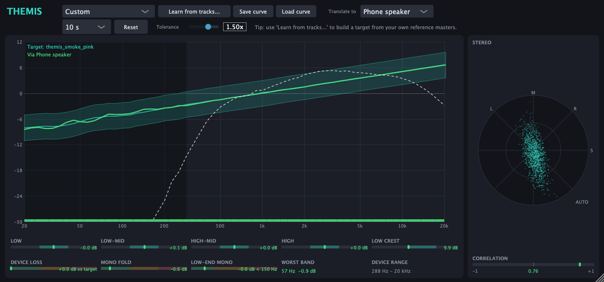

# Themis

A reference-curve plugin for FL Studio (and any VST3 / AU host) in the style of **iZotope Tonal Balance Control**: it
measures the long-term tonal balance of your master and draws it against a target band. It is **analysis only** - the
audio passes through bit-for-bit unchanged with zero latency, so it is safe to leave on the master bus.

- Formats: **VST3 + AU** (macOS, universal arm64 + x86_64, macOS 11+), VST3 + Standalone on Linux/Windows if you build there.
  FL Studio for macOS loads VST3, AU and CLAP; there is no VST2 for new plugins.
- Built with [JUCE](https://juce.com) 8. All DSP lives in a dependency-free C++17 core ([core/include/themis](core/include/themis))
  with its own unit tests.



*Headless render of the editor measuring partly-correlated stereo pink noise against a curve learned from pink noise.*

## Features

| Area | What it does |
|---|---|
| **Tonal balance curve** | 1/6-octave long-term spectrum (20 Hz–20 kHz) vs a target *median ± tolerance* band. Segments turn green / amber / red as you leave the band. Four broadband readouts (Low / Low-Mid / High-Mid / High) show your average offset from target. A **Low Crest** meter (like TBC's Low End Crest Factor) shows the peak/RMS ratio of the 20–250 Hz band in dB: left = dynamic, right = compressed; its "typical" zone (6–10 dB) is a hand-authored guess. Averaging: 10 s / 30 s / 2 min / infinite; **Reset** restarts it. **The curve does not depend on loudness:** every analysed moment is normalised by its own total energy before averaging (so gain changes, and loud choruses vs quiet verses, don't move it), and near-silent moments are gated relative to the programme level rather than at a fixed dBFS. |
| **Translation checks** | Analysis-only help for judging how a master will carry over to other playback systems. **Device preview:** pick *Translate to* → Phone speaker / Laptop / Earbuds / Bluetooth speaker / Car / Small monitors (or Off). The curve is redrawn as that device would reproduce it (dashed line) and the range it cannot reach is darkened. **DEVICE LOSS** is how much more level your track loses through the device than the target curve does (so a bass-heavy master reads high on a phone). **Mono fold** is measured per band from the same frames as the tonal curve (level independent): the strip under the curve colours each band green / amber / red by the power lost in a mono sum, and **MONO FOLD**, **LOW-END MONO** (< 150 Hz) and **WORST BAND** summarise it. Hover the readouts for the numbers. The device responses are generic approximations (a bass limit, a treble limit and a few broad bumps), not measurements of any product, and the green/amber/red limits are rules of thumb; both are defined in [Translation.h](core/include/themis/Translation.h). The audio is never filtered. |
| **Stereo vectorscope** | Goniometer (mid vertical, side horizontal) of the last ~30 ms plus a phase-correlation meter (-1 out of phase … +1 mono, ~0.4 s smoothing). The plot auto-scales to the recent peak so it stays readable at any level; click it to switch to a fixed 0 dBFS scale. Display only; the audio is untouched. |
| **Target curves** | 7 built-in starter curves (Flat, Modern Pop, Hip-Hop, EDM, Rock, Acoustic, Orchestral) **+ "Learn from tracks…"**: pick one or more reference masters (wav/aiff/flac/ogg everywhere; mp3/m4a where the OS decoder supports them, e.g. macOS) and Themis builds a target from their average, with the tolerance set by how much they disagree. Save/load as `.themiscurve`. |
| **Pass-through** | No EQ, dynamics, limiter or gain stage; reports 0 samples of latency. |

> **About the built-in curves.** They are hand-authored approximations of typical mastered material, *not* percentile
> statistics from a dataset like iZotope's. Treat them as starting points. For accuracy, use **Learn from tracks** with
> masters you trust in your genre.

## Use with SoundID Reference (Sonarworks)

SoundID Reference has no API a third-party plugin can talk to, so "pairing" is about signal-chain order and not
double-processing. Themis measures only its own input/output, so as long as SoundID sits **after** it, calibration never
affects the curve, loudness or true-peak readings.

1. **Order:** `… → Themis → SoundID Reference` (SoundID last on the master).
2. **One SoundID mode at a time:** the plugin on the master *or* the Systemwide app — not both. Running both
   double-corrects; Sonarworks users report big level drops when both are active.
3. **Never render with SoundID on.** It is for monitoring only. The Systemwide app is the safest route for FL Studio:
   send FL's output to the SoundID virtual output device and keep SoundID out of the project, so exports are always clean.
4. **Judge balance by the curve as well as by ear.** Calibrated headphones change what you hear, never what Themis measures.

## Build (macOS)

```bash
brew install cmake                    # once (Xcode command line tools required)
cmake -S . -B build -DCMAKE_BUILD_TYPE=Release
cmake --build build --target Themis_VST3 Themis_AU -j8
```

The default configuration builds a **universal** binary (arm64 + x86_64) and copies the plugins to
`~/Library/Audio/Plug-Ins/VST3` and `~/Library/Audio/Plug-Ins/Components`. JUCE is fetched automatically (needs git + network).

Then in FL Studio: *Options → Manage plugins → Find plugins* (rescan after switching Rosetta/native mode). Themis appears
under *Fx / Analyzer* (VST3 category) / *Themis Audio* (AU). On Apple Silicon the binary must be signed, ad-hoc is enough for local use:

```bash
codesign --force --deep --sign - ~/Library/Audio/Plug-Ins/VST3/Themis.vst3
codesign --force --deep --sign - ~/Library/Audio/Plug-Ins/Components/Themis.component
auval -v aufx Thms Thmi               # optional: validate the AU
```

To share builds with other people you need an Apple Developer ID certificate + notarisation; otherwise Gatekeeper
will quarantine downloaded copies (`xattr -cr Themis.vst3` for personal use).

### No Mac handy?
Push the repo to GitHub: [.github/workflows/build.yml](.github/workflows/build.yml) builds the universal VST3 + AU on a
macOS runner, runs the DSP tests, and uploads the zips as artifacts (tag `v0.1.0` to publish a release).

## Develop

```bash
make test                              # DSP unit tests, no dependencies (g++/clang++ only)
cmake -S . -B build -DCMAKE_BUILD_TYPE=Release -DTHEMIS_BUILD_SMOKE=ON -DTHEMIS_INSTALL_AFTER_BUILD=OFF
cmake --build build --target ThemisSmoke
./build/ThemisSmoke_artefacts/Release/ThemisSmoke snapshot.png   # headless processor+editor run, writes a UI screenshot
```

Layout:

```
core/include/themis/   DSP: Biquad, Eq, Compressor, Limiter, TruePeak, Loudness, StereoTools, FFT,
                       TonalAnalyzer, LowCrestMeter, StereoScope, TargetCurve, Translation, EqFit, Engine
                       (the plugin uses only TonalAnalyzer, LowCrestMeter, StereoScope, TargetCurve and Translation; the rest is a mastering chain kept with its tests)
plugin/Source/         JUCE layer: Parameters, PluginProcessor, PluginEditor, TonalBalanceView
tests/                 test_main.cpp (DSP), plugin_smoke.cpp (headless JUCE)
```

## What has and hasn't been verified

| Verified (Linux aarch64, JUCE 8.0.6) | Not yet verified |
|---|---|
| 1748 DSP checks: K-weighting vs the ITU coefficient table, −20 LUFS reference sine at 44.1/48/96 kHz, gating, inter-sample true peak, limiter ceiling, compressor curve, M/S EQ targeting, pink/white-noise spectral slopes, low-end crest meter (sine = 3 dB, band limiting, reset, NaN recovery), per-band mono fold (mono 0 dB, uncorrelated −3 dB, inverted → cancels, level independent), device profiles and the translation report, target JSON round-trip, EQ-fit error reduction, engine latency/bypass/A-B | **A macOS build** (the CI workflow does this; the code has no platform-specific paths) |
| Universal (arm64 + x86_64) VST3 + AU build on macOS, zero warnings in Themis' own sources; `auval` AU validation passes; the VST3 loads, instantiates, processes and opens its editor in a JUCE plugin host | Behaviour inside FL Studio's plugin scanner |
| Headless run of the real processor + editor: audio, parameters, state save/restore incl. custom curve, *Learn from tracks* on a WAV, pass-through is bit-exact, resizing | Loading inside FL Studio, automation, whether the Low Crest "typical" zone suits real masters, and whether the generic device profiles and translation limits match real devices and masters |

## Known limitations

- **Limiter vs full-band noise** (core library only; the plugin has no limiter): the true-peak detector is a 4× interpolator; on music it stays within ~0.1 dB of the
  ceiling, but white noise reaching Nyquist can overshoot by up to ~1 dB. Leave the −1 dBTP default for streaming masters.
- Stereo in / stereo out only.
- The analyser's FFT runs on a background thread, not the audio thread: `processBlock` only copies samples into a lock-free ring (a few µs). The Low Crest meter is the one exception: a few biquads per sample run in `processBlock`. If a bounce renders far faster than real time, the worker may skip frames; the long-term average is barely affected.
- No CLAP build yet (FL Studio can load it; add [clap-juce-extensions](https://github.com/free-audio/clap-juce-extensions)).
- **Licence:** JUCE is AGPLv3 / commercial. Personal use is fine; if you distribute Themis you must either open-source it
  under AGPL or hold a JUCE commercial licence.
